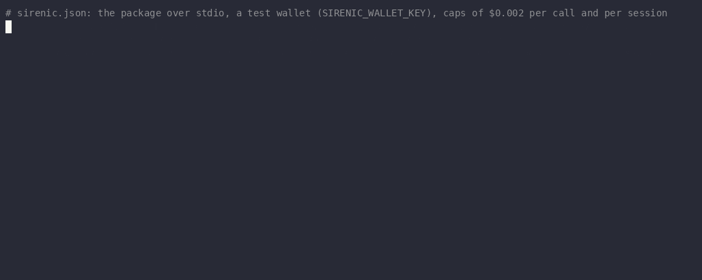

# Sirenic MCP server



**Who should we prospect in France, and can we work with this client?** Ask your agent. With this server it
[builds the list from the official French register](https://api.sirenic.eu/en/use-cases/build-b2b-prospecting-list-from-official-french-registry)
(activity code, area, legal form, workforce, age, certifications), then checks the company you are about to sign:
registers of France and Europe, officers, legal notices, VAT number and sanctions lists, with a citation of the
register it read.
Each call is paid on its own: with a free API key, or in USDC from a local x402 wallet, without an account.

`sirenic-mcp` is a local [Model Context Protocol](https://modelcontextprotocol.io) server (stdio) for Claude
Desktop, Cursor, Claude Code and any MCP client that starts a local server. **Its tool definitions live in this
repository** (`catalogue/instantane.json`), and **each tool calls the Sirenic REST API itself and pays for the call**,
by API key or by x402, within caps you set. It works without the hosted Sirenic MCP server.

## Install

Nothing to clone. In your client's MCP configuration (`claude_desktop_config.json` for Claude Desktop,
`~/.cursor/mcp.json` for Cursor):

```json
{
  "mcpServers": {
    "sirenic": {
      "command": "npx",
      "args": ["-y", "sirenic-mcp"],
      "env": { "SIRENIC_API_KEY": "srn_live_..." }
    }
  }
}
```

Claude Code, in one line:

```bash
claude mcp add sirenic -e SIRENIC_API_KEY=srn_live_... -- npx -y sirenic-mcp
```

Node.js 22 or later. Then ask, for example: *"List active computer programming companies (NAF 62.01Z) in the Rhône
department with 10 to 49 employees, then check the first one before we contact them."*

Prefer a remote server? Clients that speak streamable HTTP can use `https://api.sirenic.eu/mcp` directly (each
tool takes an `x_payment` argument), or the OAuth connector `https://api.sirenic.eu/mcp/connecteur`: see
[api.sirenic.eu/en/connectors](https://api.sirenic.eu/en/connectors).

## Two ways to pay

| Rail | Set | What happens |
|---|---|---|
| API key | `SIRENIC_API_KEY` | Each call goes to the REST API with the key in `X-Api-Key`. A free key gives 150 calls a month, up to EUR 2 of value, on most routes (the price list says which); beyond, prepaid credits are charged at the same prices. [Get a key](https://api.sirenic.eu/compte?utm_source=forge&utm_campaign=sirenic-mcp-npm). |
| x402 wallet | `SIRENIC_WALLET_KEY` | No account. When the API answers a call with its price (an x402 quote, HTTP 402), the local wallet signs a USDC payment on Base (an EIP-3009 authorization: no gas) and the same request is sent again with it. The API settles, then answers. |

When both are set, the API key pays and the wallet is never used. When neither is set, tools are listed and a paid
call returns its price and how to pay, without paying.

The wallet's private key stays in memory: it is never written to disk, logged or sent anywhere. Use a dedicated
wallet holding only what you are ready to spend.

## Caps (x402 rail)

| Variable | English alias | Default | Meaning |
|---|---|---|---|
| `SIRENIC_MAX_PAR_APPEL` | `SIRENIC_MAX_PER_CALL` | `0.05` | The most a single call may cost, in USD. |
| `SIRENIC_MAX_PAR_SESSION` | `SIRENIC_MAX_PER_SESSION` | `0.50` | The most the server process may spend, in USD. |

The wallet signs only the `exact` scheme in USDC on Base: a quote without such an option is refused
(`paiement_refuse`), nothing signed. A quote above a cap is refused before anything is signed. The tool answers `plafond_depasse` with the quoted price,
the cap and the variable to raise; the tool list itself is unchanged (tools above the cap stay listed). Most tools
cost $0.05 or less. The session cap counts the calls in progress too: a price is held against it before the
signature, so calls sent together never spend more than the cap. A payment whose outcome is unknown (the connection
broke, the call was cancelled while the payment travelled, the API could not confirm the settlement) counts against
the session cap and is never replayed.

## How it works

- **The tools are defined here.** `catalogue/instantane.json` is a dated snapshot of the Sirenic server's
  `tools/list`: names, descriptions, input schemas, each tool's routes and prices (`_meta["eu.sirenic/prix"]`) and
  its **call template** (`_meta["eu.sirenic/appel"]`: method, path, query parameters, `Accept`). It is generated by
  `npm run instantane` from the free `tools/list` of the server, never written by hand. The two payment arguments of
  the hosted tools (`x_payment`, `api_key`) are removed: the model never handles a key or a signature.
- **Each call is a REST call.** The arguments are read through the tool's input schema (unknown keys dropped, defaults
  applied, the same reading as the hosted server); the call template turns them into a `GET` under
  `https://api.sirenic.eu/v1/` (the analyser in `src/appel-outil.ts` is the one the hosted server uses, and both play
  the same test vectors). A served schema cannot say that an identifier is matched case-insensitively: a value that
  fits its pattern only in another case is sent, and the API judges it (an invalid value is answered 400, never
  charged). The paywall is the API's: this package never builds a quote, and only signs a quote the
  API returned, under your caps. Redirects are never followed.
- **Answers as the hosted server renders them.** JSON data in `structuredContent.resultat` and as text (compact
  beyond 20,000 characters, so a large batch stays readable by the client), a PDF in base64, Markdown as is; an error
  of the API with its `statut_http`. A call paid in x402 and settled returns the
  API's settlement receipt in `_meta["x402/payment-response"]` (transaction, network, payer); a payment that is not
  settled returns none, and this package never makes one up.
- **The list stays up to date.** At startup, when it answers, the hosted `tools/list` (`https://api.sirenic.eu/mcp`,
  anonymous) refreshes descriptions and withdraws a tool the server no longer serves or has changed; a tool added on
  the server is named in the startup log and comes with the next version. It is never the source of a call: without
  it, the snapshot serves and the calls still go to the API. A daily workflow of this repository compares the
  snapshot with the server and opens an issue on any difference (GitHub disables scheduled workflows after 60 days
  without activity in the repository).
- No file is written, no telemetry is sent. Every request says `User-Agent: sirenic-mcp-npm/<version>`.

Without a rail, a paid tool is not an error: it answers `payment_required: true` in `structuredContent`, with the
API's `quote`, its `free_tier` offer and a `hint` that starts with `paiement_requis` (`isError` is false).

Errors the package returns itself (a closed list, in `structuredContent.resultat.error`, `isError` true):
`argument_invalide` (the arguments do not fit the tool's schema: nothing was sent), `gabarit_invalide` (the tool's
call template gives no request: a fault of Sirenic, nothing was sent), `plafond_depasse`, `paiement_refuse`,
`reglement_incertain` (a signed payment may have been settled: it is counted and never replayed, check your
balance), `appel_annule`, `service_injoignable`. Errors of the Sirenic API itself (`amont_indisponible`,
`credits_insuffisants`, a refused key...) reach your client as served, with `statut_http`.

## Tools

<!-- tools:start (generated by npm run tableau, do not edit) -->

119 tools (115 paid, 4 free) covering France and 19 other European countries, read from the Sirenic server 1.2.1 on 2026-11-19. Prices are in USD per call (per entity for batch tools), the same by API key and by x402.

| Tool | What it does | Price |
|---|---|---|
| `check_french_regulator_alerts` | French regulator alerts (AMF) | $0.01 |
| `compare_french_companies` | Compare French companies | $0.12 per entity |
| `create_surveillance_watch` | Create a company watch | from $0.05 (30 days) up to $0.50 (365 days) per entity |
| `detect_company_identifiers` | Detect company identifiers in text (free) | free |
| `download_french_company_document` | Download French company document | $0.10 |
| `find_expiring_french_public_contracts` | Expiring French public contracts | $0.05 |
| `find_french_lookalike_companies` | Find French lookalike companies | $0.02 |
| `get_belgian_company_filing` | Belgian annual accounts (NBB) | $0.15 |
| `get_belgian_insider_transactions` | Belgian insider transactions | $0.02 |
| `get_company_licences` | French regulatory authorisations | $0.02 |
| `get_company_procurement_competitors` | French procurement competitors | $0.02 |
| `get_croatian_company_accounts` | Croatian company annual-accounts filings | $0.01 |
| `get_croatian_company_events` | Croatian company court-register entries | $0.02 |
| `get_croatian_company_insolvency` | Croatian company insolvency (Sudski registar) | $0.02 |
| `get_cypriot_company_officers` | Cypriot company officers (DRCOR) | $0.01 |
| `get_czech_company_officers` | Czech company officers (public register, ISVR) | $0.01 |
| `get_czech_company_shareholders` | Czech company shareholders (public register, ISVR) | $0.02 |
| `get_danish_company_filing` | Danish annual accounts | $0.05 |
| `get_danish_company_officers` | Danish company officers (CVR) | $0.01 |
| `get_estonian_company_accounts` | Estonian annual accounts | $0.02 |
| `get_estonian_company_officers` | Estonian company officers and governance | $0.01 |
| `get_estonian_company_registry_rulings` | Estonian registry rulings | $0.02 |
| `get_estonian_company_shareholders` | Estonian company members and shareholders | $0.02 |
| `get_eu_procurement_awards` | EU procurement awards (TED) | $0.02 |
| `get_european_company_eu_procurement` | European company EU procurement awards (TED) | $0.02 |
| `get_european_company_profile` | European company profile | $0.01 |
| `get_finnish_company_events` | Finnish trade-register notices (PRH) | $0.02 |
| `get_finnish_company_filing` | Finnish annual accounts (PRH) | $0.15 |
| `get_french_association_notices` | French association JOAFE notices | $0.01 |
| `get_french_association_profile` | French association profile (RNA) | $0.005 |
| `get_french_company_briefing` | French company briefing for an AI | $0.05 |
| `get_french_company_capital` | French company share capital | $0.35 |
| `get_french_company_changes` | French company changes (BODACC) | $0.01 |
| `get_french_company_collective_agreements` | French company collective agreements | $0.02 |
| `get_french_company_court_decisions` | French company court decisions | $0.01 |
| `get_french_company_credit_limit` | French company credit limit for a new customer | $0.12 |
| `get_french_company_default_risk` | French company default risk score | $0.10 |
| `get_french_company_default_risk_batch` | French default risk score, batch (2 to 100) | $0.07 per entity |
| `get_french_company_eu_funding` | EU research funding received (CORDIS) | $0.02 |
| `get_french_company_file` | French company file (choose blocks) | from $0.005 up to $0.35 (blocks chosen per call) |
| `get_french_company_financials` | French company financials | $0.01 |
| `get_french_company_health_summary` | French company health summary | $0.15 |
| `get_french_company_hiring_signals` | French hiring signals | $0.02 |
| `get_french_company_identity_batch` | French identity batch: SIREN, SIRET, VAT | from $0.003 up to $0.01 per entity |
| `get_french_company_industrial_risk` | French industrial risk (ICPE) | $0.01 |
| `get_french_company_intellectual_property` | French company IP portfolio | $0.03 |
| `get_french_company_intelligence` | French company intelligence report | $1.00 |
| `get_french_company_kyb_batch` | French KYB batch (2 to 100) | $0.105 per entity |
| `get_french_company_kyb_file` | French company KYB file | $0.15 |
| `get_french_company_legal_alerts` | French company legal alerts | $0.01 |
| `get_french_company_lobbying` | French lobbying register (HATVP) | $0.01 |
| `get_french_company_pdf_report` | French company PDF report | $0.50 |
| `get_french_company_profile` | French company profile (SIREN) | $0.005 |
| `get_french_company_public_procurement` | French public contracts won | $0.01 |
| `get_french_company_trajectory` | French company growth trajectory | $0.02 |
| `get_french_company_updates_since` | French company: everything new since a date | $0.05 |
| `get_french_public_buyer_profile` | French public buyer profile | $0.02 |
| `get_french_sector_benchmarks` | French sector benchmarks (NAF) | $0.05 |
| `get_german_insider_transactions` | German insider transactions | $0.02 |
| `get_irish_company_insolvency` | Irish company insolvency status (CRO) | $0.01 |
| `get_latvian_company_accounts` | Latvian annual accounts | $0.03 |
| `get_latvian_company_events` | Latvian company legal events | $0.02 |
| `get_latvian_company_insolvency` | Latvian company insolvency | $0.02 |
| `get_latvian_company_officers` | Latvian company officers | $0.01 |
| `get_latvian_company_public_procurement` | Latvian company public procurement (IUB) | $0.02 |
| `get_latvian_company_shareholders` | Latvian company members and shareholders | $0.02 |
| `get_lithuanian_company_accounts` | Lithuanian annual accounts | $0.02 |
| `get_lithuanian_company_insolvency` | Lithuanian company insolvency (JAR and AVNT) | $0.02 |
| `get_norwegian_company_accounts` | Norwegian annual accounts | $0.02 |
| `get_norwegian_company_legal_events` | Norwegian legal events | $0.02 |
| `get_norwegian_company_local_units` | Norwegian company local units (establishments) | $0.01 |
| `get_norwegian_company_officers` | Norwegian company officers and board | $0.01 |
| `get_polish_company_insolvency` | Polish company insolvency (KRS extract) | $0.02 |
| `get_polish_company_public_procurement` | Polish company public procurement (BZP) | $0.02 |
| `get_polish_company_registry_events` | Polish registry events (KRS) | $0.02 |
| `get_portuguese_company_public_procurement` | Portuguese company public procurement (Portal BASE) | $0.02 |
| `get_romanian_company_accounts` | Romanian annual accounts (Ministry of Finance) | $0.02 |
| `get_romanian_company_insolvency` | Romanian company insolvency (ONRC register) | $0.02 |
| `get_romanian_company_officers` | Romanian company legal representatives (ONRC) | $0.01 |
| `get_slovak_company_filing` | Slovak annual accounts (RUZ) | $0.03 |
| `get_spanish_company_acts` | Spanish company acts (BORME) | $0.02 |
| `get_spanish_company_public_procurement` | Spanish company public procurement (PLACSP) | $0.02 |
| `get_surveillance_watch` | Company watch status | free |
| `get_swedish_company_accounts` | Swedish annual accounts | $0.03 |
| `get_swedish_company_registry_events` | Swedish registry events | $0.02 |
| `get_swiss_company_events` | Swiss commercial-register publications (SOGC) | $0.02 |
| `get_swiss_company_insolvency` | Swiss company bankruptcy publications (SOGC) | $0.02 |
| `get_uk_beneficial_owners` | UK persons with significant control (PSC, legal entities) | $0.02 |
| `get_uk_company_accounts` | UK annual accounts (iXBRL) | $0.05 |
| `get_uk_company_gazette_notices` | UK insolvency notices (The Gazette) | $0.02 |
| `get_uk_company_insolvency` | UK company insolvency | $0.02 |
| `get_uk_company_officers` | UK company officers | $0.01 |
| `get_uk_company_public_procurement` | UK company public procurement (FTS, Contracts Finder) | $0.02 |
| `list_belgian_company_filings` | Belgian filings list (NBB) | $0.01 |
| `list_danish_company_filings` | Danish filings list (CVR) | $0.01 |
| `list_finnish_company_filings` | Finnish filings list (PRH) | $0.01 |
| `list_french_company_documents` | List French company documents (INPI) | $0.02 |
| `list_french_company_establishments` | French company establishments (SIRET) | $0.003 |
| `list_polish_company_filings` | Polish company annual-accounts filings (KRS) | $0.01 |
| `list_slovak_company_filings` | Slovak filings list (RUZ) | $0.01 |
| `list_uk_company_accounts` | UK accounts list (Companies House) | $0.01 |
| `prepare_european_invoice_file` | Prepare Belgian or Polish invoice file | $0.03 |
| `prepare_french_einvoicing_recipient` | Prepare French e-invoicing recipient | $0.02 |
| `prepare_french_invoice_file` | Prepare French invoice file | $0.03 |
| `prospect_french_companies` | Prospect French companies | $0.02 |
| `query_french_companies` | Query French companies by combined criteria | $0.002 to $0.02 |
| `renew_surveillance_watch` | Renew a company watch | from $0.05 (30 days) up to $0.50 (365 days) per entity |
| `screen_sanctions_lists` | Sanctions screening (AML) | $0.02 |
| `search_bodacc_announcements` | Search BODACC announcements | $0.03 |
| `search_eu_financial_authorisations` | Search EU financial authorisations (ESMA, ECB, EIOPA) | $0.01 |
| `search_european_companies` | Search European companies by name | $0.003 |
| `search_french_associations` | Search French associations by name | $0.002 |
| `search_french_companies` | Search French companies by name | $0.002 |
| `search_french_company_directors` | Search French company directors | $0.02 |
| `stop_surveillance_watch` | Stop a company watch | free |
| `suggest_company_names` | Suggest French company names (free) | free |
| `validate_eu_vat_number` | Validate EU VAT number (VIES) | $0.003 |
| `verify_french_invoice` | Verify a French invoice | $0.02 |
| `verify_iban_bank` | Verify IBAN and bank (SEPA) | $0.005 |

<!-- tools:end -->

## Recipes

Ready-made code for the REST API, x402 and n8n lives in
[sirenic-examples](https://github.com/sirenic-eu/sirenic-examples), the cookbook of this server.

## Limits

- Data comes from official registers and open data, served as is: a register that is late is late here too. Every
  paid response says its sources, their dates and what could not be checked (`provenance`).
- Natural persons are left out where a register mixes them with companies; a doubtful case is omitted, not served.
- The x402 rail pays in USDC on Base only. A payment cannot be refunded by this package.
- The snapshot only serves the tool list: no call works without the Sirenic server.
- No local HTTP listener in this version: use the hosted endpoint for HTTP clients.

## Star

If this server saved you a lookup, a star helps other developers find it.

[](https://star-history.com/#sirenic-eu/sirenic-mcp&Date)

## Contributing

Issues and pull requests are welcome: see [CONTRIBUTING.md](CONTRIBUTING.md). Tests run without network.

A `Dockerfile` is provided for MCP catalogues that build servers from source (Glama). It is built only by the CI of
this repository (job `docker`, which also starts the image) and by the catalogue itself: the maintainers do not build
it on their own machines.

## License

MIT, see [LICENSE](LICENSE). Data licences are those of each register, cited in every response.

Keywords: mcp, mcp-server, x402, company-data, kyb, europe, ai-agents.
